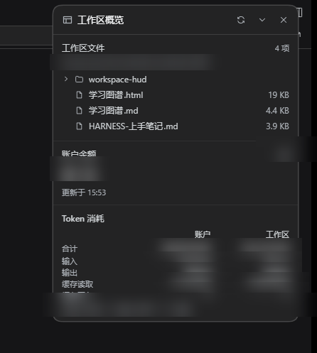

# Workspace HUD for DeepSeek Harness

[](https://github.com/LiuProMax/dsh-workspace-hud/actions/workflows/ci.yml)
[](LICENSE)
[](package.json)

A pinned, draggable overlay for the [DeepSeek Harness](https://github.com/deepseek-ai/deepseek-harness) Web UI that keeps four things in view while you work:

- the files in the current workspace,
- the current account balance,
- token usage, split into **account** and **workspace** totals,
- an estimated **workspace cost**, priced from a table calibrated from the official DeepSeek pricing page.



<sub>Screenshot: the workspace path, account name, balance, and usage figures are redacted.</sub>

English | [中文](README.zh.md)

## Features

- **Workspace files** — the current session's working directory, one level at a time (directories expand on demand), with file sizes. Click a file to open it in Harness's right-side preview. Refreshes every 8 seconds.
- **Account balance** — wallet balances and bonus credit for the signed-in account, with the account name and last update time. Refreshes every 60 seconds and whenever the window regains focus.
- **Token usage, two scopes** — a comparison table with **account** (every session on this device) and **workspace** (sessions sharing the current `cwd`) side by side, and a row for the total, input, output, cache read, and cache write of each scope.
- **Workspace cost, incrementally priced** — every 60 seconds the card fetches the price table, then prices the new token increments with the rates and the peak/off-peak coefficient in effect right then, and adds them to a per-workspace ledger. The table is calibrated from the **official DeepSeek pricing page** once a week (peak windows, weekday limits, and the peak/off-peak ratio are parsed from that page; windows are evaluated in **Beijing time**). See [docs/cost.md](docs/cost.md).
- **Live numbers** — open sessions are read from their live projections, so the totals grow while a turn streams.
- **Pinned but out of the way** — drag it anywhere on the title bar, double-click to reset. Position, collapsed state, and hidden state persist in `localStorage`.
- **Theme-native** — styled only with `--dsw-*` design tokens, so it follows light and dark themes and the host's typography.
- **Self-contained** — no npm dependencies, no build step. The only external network call is the weekly official price check.

## Requirements

- DeepSeek Harness Desktop (developed against `0.2.0-rc.2` on Windows).
- The account balance section needs Harness's desktop account service (`remote.account`). Without it the plugin stays inactive.
- Node.js 20+ only for the repository checks; the running plugin uses the Harness client runtime.

## Install

### Option A — from GitHub, through the Plugins page (recommended for Desktop)

1. Open **Plugins** in the Harness sidebar.
2. Choose **Install** and paste either form:
   - `github:LiuProMax/dsh-workspace-hud`
   - `https://github.com/LiuProMax/dsh-workspace-hud`
3. Approve the install. Harness reloads the profile live; the card appears in the top-right corner.

### Option B — manual install into the Desktop profile

Download or clone this repository, then run the installer for your platform. It copies the package into the Desktop profile and selects it in `dsh.profile.bundles`; the running app hot-reloads, no restart needed.

```powershell
# Windows PowerShell
powershell -ExecutionPolicy Bypass -File .\install.ps1
```

```bash
# macOS / Linux
bash ./install.sh
```

Both scripts back up nothing and only rewrite the profile's `dsh.profile.bundles` list; run them again after editing the plugin to update the installed copy.

### Option C — any non-Desktop DSH profile

```bash
dsh plugin --profile <profile> add github:LiuProMax/dsh-workspace-hud
```

The Desktop profile is owned by the Electron application, so `dsh plugin` refuses it — use Option A or B there.

## Usage

| Action | Result |
|---|---|
| Drag the title bar | Moves the card; the position is remembered |
| Double-click the title bar | Resets to the default top-right position |
| Click a file row | Opens the file in the right-side preview |
| Click a directory row | Expands or collapses that directory |
| Refresh button | Re-reads files, balance, and token usage |
| Chevron button | Collapses or expands the body |
| Close button | Hides the card; a small **概览** pill stays in its place |
| Click the pill | Restores the card |

## How it works

The bundle mounts one host row (`workspace-hud`) whose package also declares a `dsh.client` bundle. The browser half registers a React component into the `shell.overlay` slot, the slot Harness renders above every panel. Most data comes from existing public services; the host half adds one local price-table route:

| Section | Source |
|---|---|
| Workspace path | `cwd` of the session retained by the main view (`ctx.sessions.list`) |
| File tree | `ctx.remote.workspaceFiles.list` — read-only |
| Balance | `ctx.remote.account.getBalance` / `getProfile` |
| Token usage | `projections.values.tokenUsage` on every item of `ctx.remote.session.list`, overlaid with live session projections |
| Workspace cost | host route `GET /api/workspace-hud/pricing` (official table, calibrated weekly), priced increments in `localStorage` |

See [docs/how-it-works.md](docs/how-it-works.md) for the component flow, storage keys, and drag implementation, and [docs/cost.md](docs/cost.md) for the price table and the cost formula.

## Privacy

- The card reads only what Harness already exposes to its own Web UI. The host half writes a single file of its own — the price table — and nothing else; it never reads account credentials or session logs.
- Every value comes from the **viewer's own** local Harness: another person running this plugin sees their own sessions and account, never the publisher's. The package ships no credentials, account data, or tokens.
- No analytics, no external requests beyond the weekly official price check and Harness's own account and session services.
- State is limited to `localStorage["dsh.workspace-hud.v1"]` (position and visibility) and `localStorage["dsh.workspace-hud.cost.v1"]` (the per-workspace cost ledger).

## Limitations

- **Account usage is local.** Harness does not expose cloud billing usage to the client, so the account total sums the sessions persisted on this device. Sessions without a working directory, and subagent sessions that `session.list` does not return, are not counted.
- **Workspace cost is an estimate.** It prices observed increments at the moment they are observed (poll granularity, 60 s), has no per-model split for sessions that switched models, and excludes subagent sessions. The official page is in USD and its peak windows are weekday-only, evaluated in Beijing time; Chinese public holidays are not auto-detected. The bundled rates are a fallback sample until the first calibration.
- **Cached projections lag slightly.** Sessions that were never opened use the projection cache checkpoint (at most 200 events or 5 seconds behind). Open sessions are always live.
- **Balance is Desktop-only.** On a Web-only deployment without `remote.account`, the plugin does not mount.
- **The account client version is pinned** to the build it was developed against (`0.2.0-rc.2`). A future Harness build with a different account contract may show the balance as unavailable while the rest keeps working.

## Development

The plugin is plain JavaScript; there is nothing to compile.

```bash
git clone https://github.com/LiuProMax/dsh-workspace-hud.git
cd dsh-workspace-hud
npm run check          # manifest, patch, and client wiring checks
npm test               # pricing schema, official parser, peak windows, cost formula, staleness
node --check index.js
node --check client.js
```

To try a change in a running Desktop app, edit `client.js` and re-run `install.ps1` / `install.sh`. Harness's client HMR polls installed bundles and swaps the card in place; component state resets, session and card state survive.

Repository layout:

```
.
├── client.js              browser half: card, drag, data reads
├── index.js               host half: the mounted Loader row
├── cordis.patch.yml       bundle patch that inserts the row
├── icon.svg               plugin-manager artwork
├── install.ps1            Desktop profile installer (Windows)
├── install.sh             Desktop profile installer (macOS/Linux)
├── scripts/check.mjs      dependency-free CI check
├── docs/how-it-works.md   architecture notes
└── assets/preview.png     screenshot used by this README
```

## Contributing

Issues and pull requests are welcome. Please run `npm run check` before opening a PR, and keep the card within Harness's theme tokens and public client services. See [CONTRIBUTING.md](CONTRIBUTING.md).

## License

[MIT](LICENSE)
