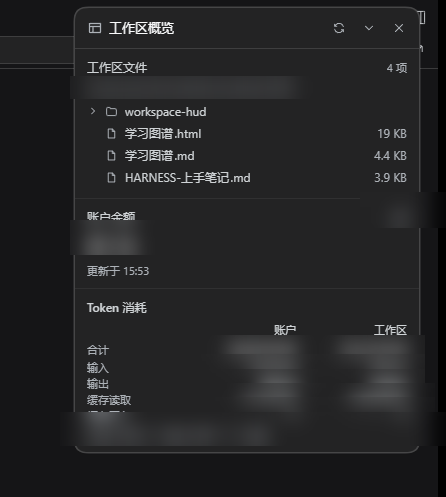

# DHS-资源统计弹窗

[](https://github.com/LiuProMax/dhs-resource-hud/actions/workflows/ci.yml)
[](LICENSE)
[](package.json)

一个置顶、可拖拽的浮窗插件，给 [DeepSeek Harness](https://github.com/deepseek-ai/deepseek-harness) 的 Web UI 常驻显示四件事：

- 当前工作区的文件；
- 当前账户的余额；
- Token 消耗，分成 **账户** 与 **工作区** 两个口径；
- **工作区花费**估值，按 DeepSeek 官方价目表计价。



<sub>截图中的工作区路径、账户名、余额与用量数字已打码。</sub>

[English](README.md) | 中文

## 功能

- **工作区文件**：当前会话工作目录的目录树（目录按需展开），文件带大小；点击文件在 Harness 右侧预览中打开。每 8 秒自动刷新。
- **账户余额**：已登录账户的钱包余额、赠送余额、账户名与更新时间。每 60 秒或窗口重新聚焦时刷新。
- **Token 消耗，两个口径**：表格里并排对比 **账户**（本机所有会话）与 **工作区**（同一 `cwd` 的会话），各自都有合计、输入、输出、缓存读取、缓存写入五行，不用切换就能对照。
- **工作区花费，增量计价**：每 60 秒先读取价目表，再把新增的 Token 增量按**当时生效**的单价与峰谷系数计价，累加到该工作区的账本。价目表每周从 **DeepSeek 官方定价页** 校准一次（高峰时段、工作日限制、峰谷倍率都从官方页面解析，窗口按**北京时间**判断，内置 2026 年中国法定节假日）。详见 [docs/cost.md](docs/cost.md)。
- **实时数字**：打开中的会话直接读实时投影，对话流式输出时数字同步增长。
- **置顶但不碍事**：拖标题栏可移动，双击回到默认位置；位置、折叠和隐藏状态都记录在 `localStorage`。
- **跟随主题**：只使用 `--dsw-*` 设计 token，明暗主题与宿主排版一致。
- **零依赖、零构建**：唯一的对外网络请求是每周一次的官方价目表校准。

## 要求

- DeepSeek Harness 桌面版（开发环境为 Windows 上的 `0.2.0-rc.2`）。
- 余额依赖桌面版账户服务（`remote.account`）；纯 Web 部署下插件不会挂载。
- Node.js 20+ 仅用于仓库自检，运行时使用 Harness 客户端的 React。

## 安装

### 方式 A：通过「插件」页从 GitHub 安装（桌面版推荐）

1. 打开 Harness 侧栏的 **插件** 页面。
2. 选择安装，粘贴以下任一形式：
   - `github:LiuProMax/dhs-resource-hud`
   - `https://github.com/LiuProMax/dhs-resource-hud`
3. 确认安装。Harness 会实时重组 profile，浮窗出现在右上角。

### 方式 B：手工安装到桌面版 profile

克隆或下载本仓库后，运行对应平台的安装脚本。脚本会把包复制进桌面 profile，并把包名加进 `dsh.profile.bundles`；运行中的 Harness 会热更新，无需重启。

```powershell
# Windows PowerShell
powershell -ExecutionPolicy Bypass -File .\install.ps1
```

```bash
# macOS / Linux
bash ./install.sh
```

脚本只改写 profile 的 `dsh.profile.bundles` 列表；改完插件代码后重新运行一次即可更新已安装副本。

### 方式 C：非桌面版 profile

```bash
dsh plugin --profile <profile> add github:LiuProMax/dhs-resource-hud
```

桌面版的 profile 由 Electron 应用独占管理，`dsh plugin` 会拒绝；桌面版请用方式 A 或 B。

## 使用

| 操作 | 结果 |
|---|---|
| 拖动标题栏 | 移动浮窗，位置会记住 |
| 双击标题栏 | 回到默认的右上角位置 |
| 点击文件行 | 在右侧预览中打开该文件 |
| 点击目录行 | 展开 / 收起该目录 |
| 刷新按钮 | 重新读取文件、余额和 Token |
| 折叠按钮 | 收起 / 展开主体 |
| 关闭按钮 | 隐藏浮窗，原位置留下「概览」胶囊 |
| 点击胶囊 | 恢复浮窗 |

## 实现方式

插件挂载一个宿主行（`workspace-hud`），其包同时声明 `dsh.client` 浏览器半。浏览器半把 React 组件注册到 `shell.overlay` 槽位——Harness 在所有面板之上渲染的那一层。大部分数据走已有的公开服务，宿主半只加了一条本地价目表路由：

| 区域 | 来源 |
|---|---|
| 工作区路径 | 主视图会话的 `cwd`（`ctx.sessions.list`） |
| 文件树 | `ctx.remote.workspaceFiles.list`，只读 |
| 余额 | `ctx.remote.account.getBalance` / `getProfile` |
| Token | `ctx.remote.session.list` 每条会话的 `projections.values.tokenUsage`，并用实时投影覆盖 |
| 工作区花费 | 宿主路由 `GET /api/workspace-hud/pricing`（官方价目表，每周校准），增量费用记在 `localStorage` |

组件流程、存储键与拖拽实现见 [docs/how-it-works.md](docs/how-it-works.md)；价目表结构与费用公式见 [docs/cost.md](docs/cost.md)。

## 隐私

- 卡片只读取 Harness 已经暴露给它自己 Web UI 的数据；宿主半只写自己的价目表文件，不读凭据，也不读会话日志。
- 所有数据都来自**加载者本机**的 Harness：别人运行这个插件看到的是他自己的会话和账户，不是发布者的；包里没有凭据、账户数据或 token。
- 无统计；除每周一次的官方价目表校准外没有额外网络请求，其余流量是 Harness 自己的账户与会话服务。
- 本地状态只有 `localStorage["dsh.workspace-hud.v1"]`（位置与可见性）和 `localStorage["dsh.workspace-hud.cost.v1"]`（各工作区费用账本）。

## 已知边界

- **账户消耗是本机口径**：Harness 不向客户端暴露云端账单用量，所以账户值是本机持久化会话的累计；没有工作目录的会话、以及 `session.list` 不返回的子代理会话不计入。
- **工作区花费是估算**：按 60 秒轮询观察到的增量、用当时生效的价目表计价；会话中途换模型时没有分模型拆分，子代理会话不计入；官方页面是美元计价，高峰窗口按**北京时间**的工作日判断；内置 2026 年中国法定节假日，这些日期按低谷计价（跨年需更新列表）；首次校准前使用内置示例价兜底。
- **缓存投影有轻微滞后**：从未打开过的旧会话使用投影缓存检查点（最多滞后 200 条事件或 5 秒）；打开中的会话始终实时。
- **余额仅限桌面版**：没有 `remote.account` 的纯 Web 部署不会挂载本插件。
- **账户客户端版本固定**为开发时的 `0.2.0-rc.2`；未来账户契约变化时余额可能显示不可用，其余功能不受影响。

## 开发

插件是纯 JavaScript，没有编译步骤。

```bash
git clone https://github.com/LiuProMax/dhs-resource-hud.git
cd dhs-resource-hud
npm run check          # 校验 manifest、patch 与 client 注册
npm test               # 价目表校验、错峰窗口、费用公式、校准过期
node --check index.js
node --check client.js
```

在运行中的桌面版里验证改动：编辑 `client.js` 后重新运行 `install.ps1` / `install.sh`。Harness 的 client HMR 会轮询已安装包并原地替换浮窗，组件内部状态会重置，会话与浮窗状态保留。

## 贡献

欢迎提交 issue 与 PR。提交前请运行 `npm run check`，并保持浮窗只使用 Harness 的主题 token 与公开客户端服务。详见 [CONTRIBUTING.md](CONTRIBUTING.md)。

## 许可证

[MIT](LICENSE)
